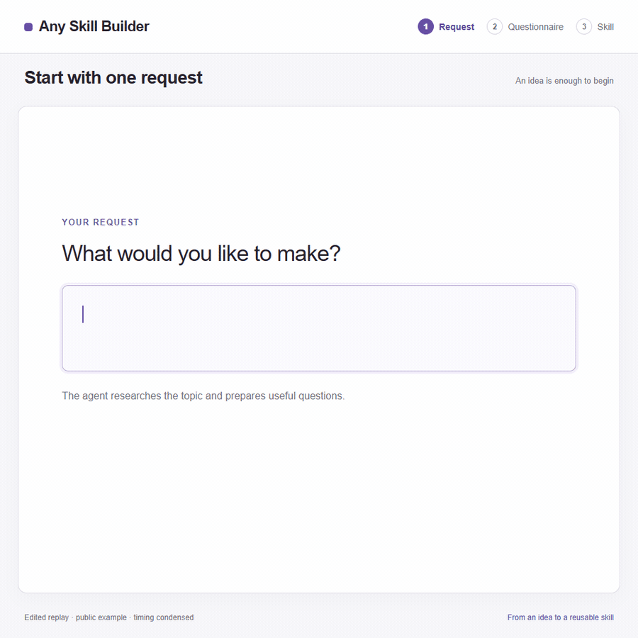
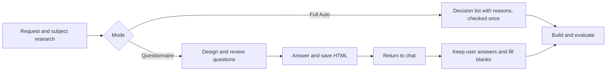

# Any Skill Builder

Turn a rough idea into a researched, usable agent skill. Discover meaningful requirements and carry the decisions through implementation and evaluation.

**Let AI handle the whole build, or answer a simple HTML questionnaire first.** The host agent does the research and judgment. A small Python helper keeps questions, answers, revisions, and build records consistent. It does not call another model or need an API key.

> **For complex skills:** consider a capable reasoning model and a higher reasoning-effort setting in your host. This can help with research, question quality, and difficult design choices. Reliable sources, clear requirements, and actual tests still matter. [Choose settings for your task](#model-and-reasoning-settings).

## Contents

- [How it works (video)](#how-it-works)
- [Two ways to build](#two-ways-to-build)
- [Results](#results)
- [Quick start](#quick-start)
  - [Install with the Skills CLI](#install-with-the-skills-cli)
  - [Install with Python](#install-with-python)
- [Example requests](#example-requests)
- [Save answers and continue](#save-answers-and-continue)
- [What makes the questions useful](#what-makes-the-questions-useful)
- [Model and reasoning settings](#model-and-reasoning-settings)
- [Requirements and languages](#requirements-and-languages)
- [Try the helper directly](#try-the-helper-directly)
- [Evaluation and related tools](#evaluation-and-related-tools)
- [Check and package](#check-and-package)
- [Releases](https://github.com/Bravery724/any-skill-builder/releases)
- [Complete example](examples/complete/README.md)
- [CI](https://github.com/Bravery724/any-skill-builder/actions/workflows/ci.yml)

## How it works

https://github.com/user-attachments/assets/3d10f534-74e7-4cd4-a69c-369cc3844fce

An 80-second walkthrough with narration and captions. It starts on the whole workflow, then zooms into each step: request, research, Full Auto or questionnaire, build, test with up to two fix rounds, and install.

## Two ways to build

| Mode | What you do | What the agent does |
| --- | --- | --- |
| **Full Auto** | Describe the skill and ask AI to decide. | Research, list the design decisions and choose each with a reason, check the choices once, then build and evaluate. No HTML is generated. |
| **Questionnaire** | Answer what matters in the HTML, save it, then say “continue” in chat. | Research and prepare questions, preserve your meaningful answers, fill the blanks, then build and evaluate. |

If your request makes the mode clear, the agent starts directly. Otherwise it offers these two choices in chat after invocation. The host controls its `/` or `$` picker; the skill does not add a native submenu to every host.

The questionnaire works as a standalone file. There is no local server, background model connection, or special defer state. For a different direction, use **Other — describe**. To let AI decide, leave the question blank.

The agent tells you at the start roughly what the work involves and how long it may take. In Questionnaire mode, question review allows one revision; evaluation runs at most two rounds in both modes. What remains open is reported as known limits. A result is **provisional** only if the final skill was never run on a realistic case. Earlier versions without these caps took tens of minutes or more, as observed in the [v0.4.1 trials](docs/review-fixes-validation.md).

## Results

In a [v0.5.0 trial](docs/full-auto-validation.md), Full Auto built a commit-message skill in 12 minutes and a Korean labor-contract review skill in 28 minutes. Building the same skills without the builder took 42 and 128 minutes. The labor build read the official minimum-wage notice and the statute texts itself.

The generated skills were then run on six inputs they had never seen, shuffled, and scored out of 10 by graders who did not know which version wrote which answer:

| Skills built by | Mean score | Labor contracts | Commit messages |
| --- | --- | --- | --- |
| v0.5.0 | **8.5** | 9, 9, 9 | 8, 9, 7 |
| v0.4.1 | 8.0 | 8, 8, 8 | 8, 8, 8 |
| No builder | 7.3 | 7, 7, 9 | 9, 8, 4 |

These are single runs with one grader per input, so small differences are within noise. The [validation notes](docs/full-auto-validation.md) list each input, the errors found, and the limits.

## Quick start

You need an agent that reads skill files, accesses local files, and runs Python. Python **3.10+** is supported; use a maintained **3.13+** release for a new installation. Check `python --version`; substitute `python3` if that is your command.

### Install with the Skills CLI

If you already use Node.js 22.20+, run this in your project:

```sh
npx skills add Bravery724/any-skill-builder --skill any-skill-builder
```

Choose your host when prompted. Add `-g` for a shared installation. Keep `--skill any-skill-builder` so only the builder is selected. The [Skills CLI](https://github.com/vercel-labs/skills) is an optional third-party installer; Python is still required. See [installation details](docs/installation.md#install-with-the-skills-cli) for a pinned release and verification.

### Install with Python

1. Download `any-skill-builder-0.5.1-source.zip` from [Releases](https://github.com/Bravery724/any-skill-builder/releases) and extract it.
2. Enter the extracted source folder containing `README.md` and `tools/`, then run:

   ```sh
   cd any-skill-builder-0.5.1-source
   python -B tools/install_skill.py --dest "~/.agents/skills"
   ```

   Choose the directory your host actually reads. The installer appends `any-skill-builder/`, checks the files, and reports the installed path. It protects a differing existing installation.
3. Refresh your host's skills or start a new session, then ask:

   > Use any-skill-builder in Full Auto to create a skill that analyzes papers from any field and develops testable research ideas.

The agent should show its stage, research the topic, resolve useful design choices, and deliver a skill with a usage guide and observed verification. Use `$any-skill-builder` if your host supports that spelling.

For the smaller runtime ZIP, host paths, troubleshooting, safe updates, rollback, and removal, see [installation](docs/installation.md). The runtime ZIP contains the skill; the source ZIP adds tests, examples, and the installer.

**Host evidence has a version boundary.** The [v0.5.0 Full Auto validation](docs/full-auto-validation.md) records build times and a blind comparison of generated skills. The [v0.4.1 validation](docs/review-fixes-validation.md) records actual Claude Code CLI trials, browser save/reopen checks, feedback-driven corrections, and their limits. Earlier native-discovery and Antigravity CLI runs are [historical evidence](docs/host-validation.md), not verification of later workflows or either IDE extension. See also the [v0.3.0 offline validation](docs/offline-validation.md), [recorded workflow examples](examples/offline-workflows/README.md), and the current commit's CI.

## Example requests

These requests create reusable skills. Use the delivered skill afterward to perform its task. Write naturally in your own language.

**Full Auto:**

```text
Use any-skill-builder in Full Auto to create a skill that analyzes papers
across research fields and develops testable new ideas. Research relevant
methods, decide the design questions, explain the key assumptions, and
build and evaluate the skill. Include a short usage guide.
```

**Answer a questionnaire:**

```text
Use any-skill-builder to create a skill for designing clear dashboard
interfaces. Research the topic and make an HTML questionnaire.
Show meaningful image candidates where your tools allow it.
Let me describe another direction through Other if none fit.
```

**Continue after saving:**

```text
Continue building from the saved HTML. Keep my answers and decide the blanks.
```

In the same conversation, “continue” is enough when the saved questionnaire is identifiable at the recorded location. If you saved to another location, provide the path or file. The agent checks run identity and versions instead of guessing between conflicting copies.

**Improve an existing skill:**

```text
Use any-skill-builder in Full Auto to improve the skill in the folder
I provide. Preserve working behavior, research the gaps, and compare
the revision with the original on the same cases. Explain what improved
and what remains untested.
```

See [more examples](docs/usage.md) for webtoons, questionnaire-only work, and using the generated skill.

## Save answers and continue



An edited replay of the fictional weekly-update example using the offline questionnaire. The saved-file step is real; the finished skill and its nine recorded checks are existing example evidence, not a new model run or a timing claim. [Static preview](docs/assets/questionnaire.jpg) · [Walkthrough](examples/complete/README.md) · [Demo details](docs/demo.md).

The card questionnaire shows the original request, question counts, and answered/unanswered states. It supports conditional questions, actual image candidates, **Other — describe**, clearing an answer, and a confirmed full reset. There is no fixed question limit; related questions are split across manageable pages.

**Save answers** is available on every page, including the first. It downloads a self-contained HTML with the questions, images, and answers. Save it in the original location when practical, then return to chat. The browser may instead use its Downloads folder or add a filename suffix; a download does not guarantee the original was overwritten.

On continuation, the agent imports the matching saved file, retains meaningful user choices, and answers the blanks. Core questions recommend a direct answer but can also be left to AI. “None”, `0`, unfamiliar technical terms, and unusual creative preferences are not rejected merely for being short or different. Clearly unusable text is reviewed in context by the agent, retained in the record, and replaced with an explained decision.

The browser does not run a model. Saving is not proof that the agent has read the file and does not wake a closed conversation. Returning to chat starts the next step. Full Auto avoids this handoff entirely and creates no HTML.

## What makes the questions useful

- Each question identifies a behavior, input, output, constraint, or evaluation it changes.
- Sources distinguish inspected evidence, partial access, AI interpretation, and proposals.
- Important recommendations are reviewed against viable alternatives and conditions that would change them.
- User requirements and meaningful custom answers remain authoritative.
- Conditional questions follow dependencies; relevant changes invalidate stale answers while retaining history.
- The build maps decisions to implemented features and checks actual task behavior.
- Every generated skill includes a usage guide, starting request, and observed limitations.



## Model and reasoning settings

The host model performs research synthesis, question design, implementation, and review. A model stronger at those tasks, with enough reasoning effort, is a sensible choice for complex builds. More inference-time computation can help under suitable conditions, but benefits depend on the task and method. This is a practical recommendation, **not a measured success-rate claim for this builder**. [Research on inference-time compute](https://arxiv.org/abs/2408.03314).

- Consider a capable reasoning model and higher effort for unfamiliar subjects, conflicting requirements, or substantial code and evaluation.
- Normal effort may be enough for a small wording change or straightforward reuse.
- Higher effort can take longer and may cost more. Check source support, question quality, and actual behavior; explanation length is not a quality measure.

Choose settings in the host. Writing “think harder” does not change the actual setting, and this skill does not silently switch your model, provider, or effort.

## Requirements and languages

| Component | Requirement |
| --- | --- |
| Host agent | Reads Agent Skills, accesses files, and executes Python; research and images use its available tools |
| Runtime | Python 3.10+, standard library only; maintained 3.13+ recommended for new installations |
| Questionnaire | Modern browser for the standalone HTML; no server or model credentials |
| Optional Skills CLI installer | Node.js 22.20+; Python/ZIP installation does not require Node.js |
| Maintainer form tests | Node.js 22+ with the built-in test runner and `Blob` |

The skill uses the [Agent Skills directory format](https://agentskills.io/specification). Discovery paths and permissions vary by host. Optional `agents/openai.yaml` supplies picker metadata where supported. Uploading a ZIP to an ordinary chat interface alone does not grant file or command access.

Reusable instructions, references, README files, comments, and metadata default to **English**. Questions, interface wording, chat, and task outputs follow **the conversation's language**. An explicit language request takes precedence. English and Korean dictionaries are bundled; other languages use host-authored translations with matching message keys. No language picker is required. This does not certify every translation or input method.

## Try the helper directly

This structural preview uses the published fixture and explicitly selects legacy review policy. It demonstrates the form, not a newly performed semantic review. For real authoring, omit that flag: new runs require a recorded review. See the [question review workflow](any-skill-builder/references/question-review.md).

From the source root, choose a fresh workspace outside the repository:

```sh
python -B any-skill-builder/scripts/skill_builder.py init --workspace ../builder-runs/my-example --goal "Build a weekly update skill" --mode questionnaire --review-policy legacy
python -B any-skill-builder/scripts/skill_builder.py set-questions --workspace ../builder-runs/my-example --input examples/questionnaire.json --rebind-project
python -B any-skill-builder/scripts/skill_builder.py validate --workspace ../builder-runs/my-example
python -B any-skill-builder/scripts/skill_builder.py render --workspace ../builder-runs/my-example
```

Open the reported HTML, answer, and choose **Save answers**. If saved back to its recorded location:

```sh
python -B any-skill-builder/scripts/skill_builder.py resume --workspace ../builder-runs/my-example
```

Or supply the saved file explicitly:

```sh
python -B any-skill-builder/scripts/skill_builder.py import-answers --workspace ../builder-runs/my-example --input /path/to/saved/questionnaire.html
```

The host reviews the imported answers and authors recommendations before running `recommend`. That helper only applies recorded recommendations; it does not do research or call AI. Full commands, restoration, and conflict handling are in the [workflow guide](any-skill-builder/references/workflow.md).

## Evaluation and related tools

Full Auto records a short decision list (question, alternatives, choice, reason, sources) and checks it once: fixed requirements kept, no ruled-out choice, no invented private facts. If you later want to answer yourself, `decisions-to-questions` turns it into a questionnaire. Questionnaire authoring includes a version-bound question review before HTML rendering or AI recommendations: fixed requirements apply to every option, recommended and contrasting answer combinations are checked, and visible explanations follow the conversation language. The host performs those judgments; the helper checks coverage and recorded outcomes. A pass is not proof of perfect questions. Existing saved runs keep their data and can enable the policy with `require-review`.

Check three different things: helper correctness, question quality, and the created skill's real task behavior. Tests of the first do not prove the other two. The [evaluation helper](any-skill-builder/references/evaluation.md) checks existing artifacts, aggregates evidence-backed reviews, and compares runs only when recorded conditions match. It does not execute a model, invent review results, or optimize descriptions automatically.

The [execution and improvement loop](any-skill-builder/references/evaluation.md) makes the last stage concrete:

1. Plan representative tasks and meaningful checks before inspecting their outputs. Include a trap (something that looks wrong but is correct) and, where relevant, fake secrets the output must not repeat. Preserve the skill and inputs for each iteration.
2. Have an executor use the skill with only the real task and input. Use a separate reviewer where available; label author review honestly when it is the only option.
3. Review both the outputs and the checks: could a wrong answer pass, is a key outcome missing, or is a claim unsupported?
4. Correct supported failures and run the affected tasks again in a new iteration. Compare against no skill or the preserved old version when that comparison matters; for legal, medical, financial, or safety advice, always run that comparison on the main case.
5. Inspect actual execution records for repeated operations. Extract a reusable helper only when the observed repetition justifies it, then test the helper and rerun the affected skill tasks.
6. Freeze the final runtime, including its README, before the last execution. Verify the delivered folder against that tested snapshot; edits after testing require a new matching iteration. For ZIP delivery, also compare the archive and extracted runtime.

Python prepares snapshots, task packets, and pending records; the host performs the actual model work and judgments. Earlier results remain available. Missing evidence stays untested, and weak-check findings remain visible even when individual assertions pass. The loop uses ordinary files and Markdown reports: Full Auto still creates no HTML, and Questionnaire still resumes from saved answers without a server or another approval round. A tie or insufficient evidence is an acceptable comparison result.

To prepare the public example's two task cases in a fresh directory:

```sh
python -B any-skill-builder/scripts/prepare_evaluation.py --plan examples/evaluation-plan.json --skill examples/complete/weekly-team-update --out ../builder-runs/update-evaluation/iteration-1
```

Input snapshots retain their plan-relative directory tree, so declared HTML/CSS, document/image and configuration/data relationships remain intact. Executor packets show original-to-snapshot mappings; unrelated files are not copied.

This creates pending work, not test results. Give the reported executor packets to your host; record actual outputs and reviews before running `evaluate_skill.py`. See the [record format](any-skill-builder/references/evaluation.md) for evidence and review fields.

After execution and review, use:

```sh
python -B any-skill-builder/scripts/verify_delivery.py --skill /path/to/final-skill --evaluation /path/to/final-iteration/evaluation.json
```

The verifier requires an executed candidate snapshot, passing checks and recorded reviews without unresolved blocking findings, and exact delivered file hashes. Add `--archive /path/to/skill.zip --extracted /path/to/extracted/skill-name` for ZIP delivery. It does not authenticate agent isolation or replace semantic review.

The [v0.5.0 Full Auto validation](docs/full-auto-validation.md) records the current build times and blind comparison; the [v0.4.1 review-fix validation](docs/review-fixes-validation.md) records the review fixes and their scope. Historical [v0.4.0 validation notes](docs/evaluation-validation.md) distinguish mechanical checks, actual host execution, and untested comparisons. A [recorded two-iteration example](examples/evaluation-loop/README.md) shows passing outputs whose evaluation still needed correction, followed by a fresh rerun.

| Tool | Emphasis |
| --- | --- |
| Any Skill Builder | Subject research, meaningful conditional questions, automatic or saved-file decisions, and evidence-backed execution and revision traced to those decisions |
| [Anthropic skill-creator](https://github.com/anthropics/skills/tree/main/skills/skill-creator) | Skill iteration with evaluation workflows, benchmark aggregation, and description/trigger improvement tools |
| [writing-skills](https://github.com/obra/superpowers/tree/main/skills/writing-skills) | Testing instructions through baseline failures, application, and behavioral rechecks |

These approaches can complement each other. Research and evaluation are not exclusive to this project, and no benchmark superiority is claimed.

The v0.4.0 additions adapt evaluation-process ideas from the linked Anthropic skill-creator through original implementation. No Anthropic source files are bundled.

## Check and package

```sh
python -B -m unittest discover -s tests -p "test_*.py"
node --test tests/test_form.mjs tests/test_form_notes.mjs tests/test_form_actions.mjs
python -B tools/check_release.py
python -B tools/check_example.py
python -B tools/package_release.py --out dist
```

`check_example.py` checks existing public evidence; it does not rerun a model. Keep real research, answers, generated user content, and run folders outside the repository. Archives use an explicit file allowlist.

```text
any-skill-builder/   Installable runtime skill
examples/           Public fixtures and recorded task evidence
tests/              Backend and form regressions
tools/              Release checks, installer, and packaging
docs/               Usage, design, validation, and release guidance
.github/workflows/  Windows and Linux CI
```

See [testing](docs/testing.md), [release preparation](docs/releasing.md), [contributing](CONTRIBUTING.md), and [security](SECURITY.md). Licensed under [MIT](LICENSE).
