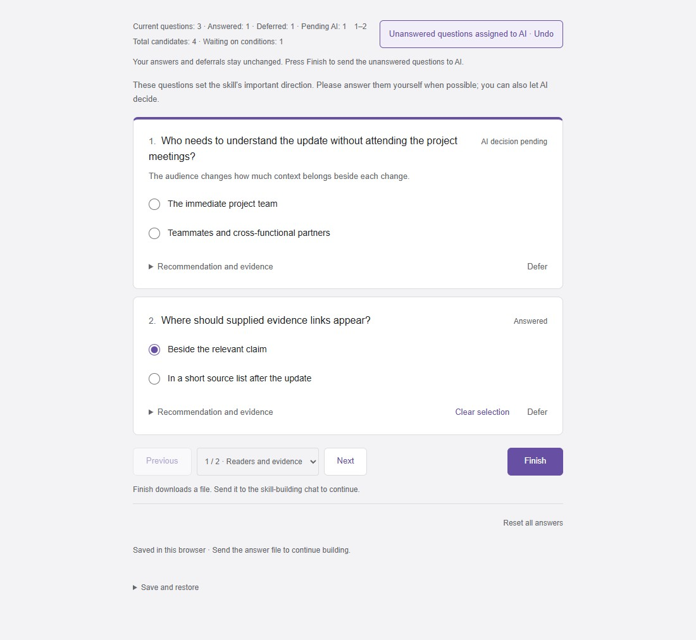
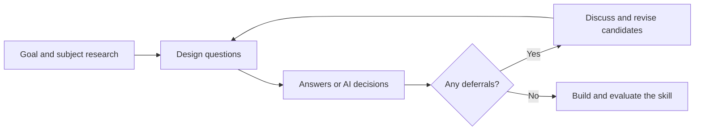

# Any Skill Builder

[Releases](https://github.com/Bravery724/any-skill-builder/releases) · [Install](#quick-start) · [Usage](any-skill-builder/README.md) · [Complete walkthrough](examples/complete/README.md) · [Validation](https://github.com/Bravery724/any-skill-builder/actions/workflows/ci.yml)

Turn a rough idea into a researched, usable agent skill. Discover meaningful requirements, keep decisions editable, and carry them through implementation and evaluation.

The host agent researches the topic, asks useful questions, and creates the final skill. A small Python helper keeps decisions consistent in a paginated card questionnaire or a chat-only workflow. It does not call a model or require an API key of its own.

Use it to **create a new skill**, **improve an existing skill**, or **work out the right questions before building**.

> Use $any-skill-builder to create a skill that analyzes research papers and develops testable ideas. Research the subject, recommend answers, and continue through implementation.



The screenshot uses fictional public example data. Open the [complete walkthrough](examples/complete/README.md) to follow the goal, sources, questions, decisions, generated skill, and observed evaluation results. The [small questionnaire fixture](examples/questionnaire.json) is also available for testing the helper alone.

## Quick start

You need an agent that can read skill files and run local Python commands. Install a maintained Python release, preferably **3.13 or newer**; the minimum compatible version is 3.10. Check `python --version`. If your system uses `python3`, substitute that command below.

### Install with the Skills CLI

If you already use Node.js 22.20+, run this in your project:

```sh
npx skills add Bravery724/any-skill-builder --skill any-skill-builder
```

Choose your host when prompted. This installs into the current project; add `-g` for an installation shared across projects. Keep `--skill any-skill-builder` so only the builder is selected. The [Skills CLI](https://github.com/vercel-labs/skills) is an optional third-party installer; Python is still required to run the builder. See [CLI details](docs/installation.md#install-with-the-skills-cli) for a pinned release and verification.

After installation, refresh your host's skills and use the starting request below. To install without Node.js, use the source ZIP:

### Install with Python

1. Open [Releases](https://github.com/Bravery724/any-skill-builder/releases) and download `any-skill-builder-0.2.0-source.zip`. Extract it. You can also use **Code → Download ZIP** and open its extracted root folder.
2. In a terminal, enter the extracted source folder containing `README.md` and `tools/`, then run the installer. From the parent of the named release folder:

   ```sh
   cd any-skill-builder-0.2.0-source
   python -B tools/install_skill.py --dest "~/.agents/skills"
   ```

   Choose the skills directory your host reads; `~/.agents/skills` is the example convention. The installer appends `any-skill-builder/`, verifies its files, and reports the absolute installed path. It protects a different existing installation.
3. Refresh the host's skills or open a new session if required. Confirm **Any Skill Builder** appears in its available skills. A successful file copy alone does not prove host discovery.
4. Ask the agent:

   > Use any-skill-builder to create a skill that analyzes research papers and develops testable ideas. Research the subject, recommend answers, and continue through implementation.

   The agent should show its current stage, research the subject, prepare decisions, and create a skill with verification results. To answer the questions yourself, say so in your request. Use `$any-skill-builder` if your host supports that syntax.

For the smaller runtime ZIP, troubleshooting, and safe **updates, rollback, and removal**, see [installation](docs/installation.md). The runtime ZIP contains the skill; the source ZIP also contains the installer, tests, and examples.

## What it does

- Connects each question to an actual design choice, with sources, recommendations, and explicit assumptions.
- Supports user answers, AI suggestions, or fully delegated AI decisions.
- Offers a single AI-delegation toggle above the questions and a Finish action on every page, preserving existing answers and deferrals.
- Resets all answers in one confirmed action while keeping the questionnaire and prior response history.
- Shows conditional questions and actual image candidates without imposing a fixed question limit.
- Saves answers, preserves revision history, and keeps user deferrals separate from missing answers.
- Revisits deferred choices in chat after the full questionnaire, then presents revised candidates.
- Builds the skill only after the active decisions are resolved, and evaluates its behavior as well as its file structure.
- Includes a concise usage guide and starting request with each newly generated skill, plus short picker metadata when the host supports it.
- Improves an existing skill while preserving a baseline and testing changed behavior.
- Records artifact checks and evidence-backed reviews separately, with explicit failures and untested cases.



## Requirements

| Component | Requirement |
| --- | --- |
| Host agent | Reads Agent Skills, accesses local files, and executes Python; research and image candidates use its available tools |
| Runtime | Python 3.10+; a maintained 3.13+ release is recommended for a new installation; standard library only |
| Questionnaire | A modern browser; live delivery also needs the local server and host task to remain active |
| Maintainer tests only | Node.js 22+ with the built-in test runner, `Blob`, and `Intl.Segmenter` |

There are no runtime package downloads or bundled model credentials. Uploading a ZIP to an ordinary chat interface does not by itself provide the required file and command access. See the [verified environment scope](docs/installation.md#verified-scope) before assuming another host has been tested.

The skill follows the [Agent Skills directory format](https://agentskills.io/specification). Host discovery and installation paths vary; use your host's documented skill installation flow. The optional `agents/openai.yaml` supplies interface metadata for hosts that support it.

## Answer, delegate, and resume

The installed builder includes a [short user guide](any-skill-builder/README.md). Invoke it without a task to get a brief introduction and a starting example, or ask for help directly. It reuses a purpose already supplied in the conversation and starts clear tasks without repeating an introduction. Picker descriptions and invocation spelling depend on the host.

Example request:

> Use any-skill-builder to improve this existing skill. Preserve what works, research the gaps, and let me answer the design questions in chat.

Use `$any-skill-builder` if your host supports that invocation syntax. For a user-completed questionnaire, ask the agent to let you answer. To resume, provide the existing run directory; do not initialize it again. Runs from the former `skill-builder` name remain valid. Changing the skill's name does not reset questions, answers, or browser draft identities.

While answering, choose **Let AI decide unanswered questions**, then **Finish** on any page to hand the remaining decisions to the active agent. The top toggle can be cancelled before finishing and does not send a request by itself. If you finish with unanswered questions and no delegation selected, an inline prompt offers **Let AI decide and finish** or **Keep answering**, which returns to the first unanswered question. Previous/next controls only navigate; visiting the last page is unnecessary. **Reset all answers** clears choices, deferrals, and the pending delegation preference if you want a fresh start; previous responses remain in history. Offline Finish downloads an answer or delegation-request file to return to the chat.

Core questions set the skill's important direction. The form recommends answering them yourself, while allowing AI to answer any or all of them through the same delegation controls. The host reviews consequential recommendations against viable alternatives, the conditions that would change them, and conflicting choices. Information needed only when the finished skill runs stays a runtime input. After AI decides, it briefly explains the main directions and assumptions in chat before continuing.

Submission acceptance and AI receipt are separate. The form confirms acceptance; the host reads the saved answers, acknowledges that exact submission, and reports receipt in chat. The completion panel can copy a token-free resume message, with selectable text if clipboard access fails. Saved stage checkpoints show the last confirmed progress and next action. They do not claim that a stopped agent is still running, and an offline downloaded file must still be given to the host.

Recovery downloads with unfinished multi-select choices preserve those selections as drafts. Load the file into a matching standalone/offline questionnaire to continue editing, then use Finish to create the normal handoff file. If you were using a live form, ask the host for an offline copy of the existing run. Run identity and revisions must match; an older draft must not overwrite newer decisions. A recovery draft is not a submitted answer or an AI request.

## Language defaults

| Content | Default |
| --- | --- |
| This repository and new reusable skill packages | English instructions, references, README files, comments, and metadata |
| Questions, interface wording, chat, and task outputs | The conversation's language |
| User material, translations, and Unicode test samples | Preserved without automatic translation |

An explicit language request overrides the applicable default. The host sets the form language naturally; users do not need a language picker. English and Korean UI dictionaries are bundled. Other languages use a complete host-authored dictionary with the same keys and placeholders. This is not a claim that every translation or input method has been tested.

New runs have an explicit English fallback locale. Existing runs keep their chosen locale; legacy runs without a locale retain their original Korean fallback. See [language support](any-skill-builder/references/language-support.md).

## Try the helper directly

These developer-oriented commands run from the source root with a fresh sibling workspace. `--rebind-project` binds the public authored fixture to the chosen folder name; it is restricted to empty initialized runs and cannot import another run's answers or identity. The example is an original proposal fixture, not completed subject research.

```sh
python -B any-skill-builder/scripts/skill_builder.py init --workspace ../any-skill-builder-runs/my-example --goal "Build a weekly update skill" --mode user
python -B any-skill-builder/scripts/skill_builder.py set-questions --workspace ../any-skill-builder-runs/my-example --input examples/questionnaire.json --rebind-project
python -B any-skill-builder/scripts/skill_builder.py validate --workspace ../any-skill-builder-runs/my-example
python -B any-skill-builder/scripts/skill_builder.py render --workspace ../any-skill-builder-runs/my-example
python -B any-skill-builder/scripts/skill_builder.py serve --workspace ../any-skill-builder-runs/my-example --timeout 3600
```

Open the exact loopback URL printed by `serve`. It contains a run token and must not be published. Keep the serving process and host task active while answering. A completed submission returns an event for the host to process. The HTML file cannot wake a closed AI conversation.

The offline HTML is a fallback: give its Finish download to the host for `import-answers` or `delegate`, according to the file type. Browser recovery drafts with unfinished selections belong back in the questionnaire. Importing ordinary answers does not submit them; the host uses `submit` for a final completed answer file, then acknowledges the accepted record. Update an existing standalone form with `render`; never reset its answers just to refresh the UI. Full commands and conflict handling are in the [workflow guide](any-skill-builder/references/workflow.md).

## Repository layout

```text
any-skill-builder/   Installable runtime skill
examples/            Small, public, English questionnaire fixture
tests/               Backend and mock-DOM form regressions
tools/               Release checks, explicit file manifest, packaging
docs/                Design, testing, and release guidance
.github/workflows/   Windows and Linux CI configuration
```

Keep real research, answers, generated user content, and run folders outside the repository. Release archives are built from an explicit file allowlist; they do not collect arbitrary local files.

## Evaluation and related tools

Check three different things: whether the helper works, whether questions uncover useful decisions, and whether the created skill performs its actual task. Test counts for the first do not prove the other two. The [evaluation helper](any-skill-builder/references/evaluation.md) checks existing output artifacts, aggregates evidence-backed reviews, and compares runs only when their recorded conditions match. It does not execute a model, invent review results, or optimize descriptions automatically.

| Tool | Emphasis |
| --- | --- |
| Any Skill Builder | Subject research, editable conditional questions, deferred-choice discussion, decision history, and implementation from those decisions |
| [Anthropic skill-creator](https://github.com/anthropics/skills/tree/main/skills/skill-creator) | Skill iteration with evaluation workflows, benchmark aggregation, and description/trigger improvement tools |
| [writing-skills](https://github.com/obra/superpowers/tree/main/skills/writing-skills) | Testing skill instructions through baseline failures, application, and behavioral rechecks |

These workflows can complement each other. Research and evaluation are not exclusive to this project, and no benchmark superiority is claimed. Use compatible evaluation tools already available in the host, or the bundled artifact helper without adding another provider dependency.

## Check and package

```sh
python -B -m unittest discover -s tests -p "test_*.py"
node --test tests/test_form.mjs tests/test_form_notes.mjs tests/test_form_actions.mjs
python -B tools/check_release.py
python -B tools/check_example.py
python -B tools/package_release.py --out dist
```

`check_example.py` checks the consistency of existing public evidence and reports; it does not run a new model evaluation. See [testing](docs/testing.md) for test scope and temporary-directory settings, and [releasing](docs/releasing.md) for package contents and publication steps. CI is configured for Ubuntu and Windows with Python 3.10/3.13 and Node 24; a configuration file alone is not proof of a completed hosted run.

## Limits

The helper validates records, not the insightfulness of questions or the quality of the final skill. The host must actually review sources, resolve conflicting decisions, inspect visual candidates, and exercise generated helpers. Mock input tests do not cover every native OS input method. The live server is a local workflow bridge, not a hosted multi-user service.

## License

[MIT](LICENSE). The installable skill includes the same [license notice](any-skill-builder/LICENSE).
